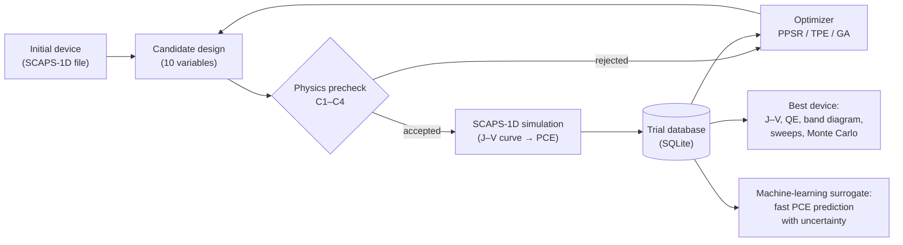

# Multi-algorithm SCAPS-1D optimization of a lead-free FTO/WO3/MASnIBr2/CBTS/Au solar cell

This repository contains the code, data and trained models of a study that searches for the best design
of a lead-free tin-perovskite solar cell. A device simulator (SCAPS-1D) is driven automatically from Python,
three optimization algorithms look for the layer settings that give the highest power conversion efficiency
(PCE), and a machine-learning model learns to predict the PCE in a fraction of a second.

You do **not** need SCAPS-1D or any prior knowledge of the project to explore the results:
all simulations are saved in this repository, and the main notebook rebuilds every table and figure from them.
A second, clean notebook runs the complete workflow from the first SCAPS-1D simulation to the last figure,
for anyone who wants to repeat the study or apply it to another device.

---

## Contents

1. [What does this project do?](#1-what-does-this-project-do)
2. [Which level suits you?](#2-which-level-suits-you)
3. [Quick start (step by step)](#3-quick-start-step-by-step)
4. [How the workflow works](#4-how-the-workflow-works)
5. [What is in the repository](#5-what-is-in-the-repository)
6. [Guide to the notebooks](#6-guide-to-the-notebooks)
7. [The ten design variables](#7-the-ten-design-variables)
8. [Using the data and the trained models](#8-using-the-data-and-the-trained-models)
9. [Running the SCAPS-1D simulations yourself](#9-running-the-scaps-1d-simulations-yourself)
10. [Glossary](#10-glossary)
11. [Troubleshooting](#11-troubleshooting)
12. [Citation, licence and acknowledgements](#12-citation-licence-and-acknowledgements)

---

## 1. What does this project do?

A solar cell is a stack of thin layers. Its efficiency depends on how thick each layer is, how strongly it is
doped and how many defects it contains. Changing one setting at a time is slow and misses the way the settings
affect each other. This project changes **ten settings together** and lets an algorithm decide which device
to simulate next.

**The device** (light enters through the FTO side):

| Layer | Material | Role |
|---|---|---|
| Front contact | FTO (fluorine-doped tin oxide) | transparent electrode |
| Electron transport layer (ETL) | WO3 (tungsten oxide) | collects electrons |
| Absorber | MASnIBr2 (methylammonium tin iodide bromide) | absorbs light; lead-free perovskite |
| Hole transport layer (HTL) | CBTS (Cu2BaSnS4) | collects holes |
| Back contact | Au (gold, work function 5.10 eV) | metal electrode |

**Main result.** The simulated PCE rises from 17.80% for the initial device to 25.27% for the best design
(Voc = 1.416 V, Jsc = 19.99 mA cm-2, FF = 89.30%). This is a simulated value for a device with a very low
absorber defect density, i.e. a target for high-quality films, not a measured efficiency.

**Three optimization algorithms** were compared, each with six random seeds:

| Algorithm | Idea in one sentence |
|---|---|
| TPE (tree-structured Parzen estimator) | a Bayesian method that models which settings gave good results and samples there more often |
| PPSR (progressive parameter-space refinement) | runs TPE in rounds of 200 trials, narrows the ranges of the most important variables after each round (using SHAP), and stops by itself when the result no longer improves |
| GA (genetic algorithm) | evolves a population of designs by selection, crossover and mutation |

---

## 2. Which level suits you?

| Level | What you need | What you can do | Time |
|---|---|---|---|
| **1. Just look** | a web browser | read the notebook with all outputs and figures directly on GitHub; open the CSV files | minutes |
| **2. Re-run the analysis** | Python 3.10 or newer | rebuild every table and figure from the saved simulations (`RUN_SIMULATIONS = False`) | about 1 hour |
| **3. Re-run everything** | Windows, SCAPS-1D 3.3.11 and Python | repeat all SCAPS-1D simulations with the clean notebook, or optimize your own device | about 3–4 days |

**The two notebooks**

| Notebook | What it is | Use it to |
|---|---|---|
| [`MASnIBr2_SCAPS_optimization.ipynb`](notebook/MASnIBr2_SCAPS_optimization.ipynb) (main notebook) | the analysis of this study with all outputs shown; it reads the saved simulations in `results/` | read the results (level 1) or re-run the analysis without SCAPS-1D (level 2) |
| [`MASnIBr2_workflow.ipynb`](notebook/MASnIBr2_workflow.ipynb) (clean notebook) | the same workflow as one linear notebook, from top to bottom, without outputs; every step that needs SCAPS-1D runs it, and all results are written to a new folder `output/` | run the whole study from scratch (level 3), or use it as a starting point for your own device |

Both notebooks use the same helper code (`src/scaps_tools.py`) and the same settings.

---

## 3. Quick start (step by step)

**Level 1.** Open [`notebook/MASnIBr2_SCAPS_optimization.ipynb`](notebook/MASnIBr2_SCAPS_optimization.ipynb)
on GitHub. All outputs are already shown. The figures are also in [`results/figures`](results/figures).

**Level 2.**

1. Install Python 3.10 or newer. Beginners can install [Anaconda](https://www.anaconda.com/download),
   which already contains Python and Jupyter.
2. Download this repository: green **Code** button → **Download ZIP**, then unzip it.
   With git: `git clone https://github.com/ATOL07/MASnIBr2-SCAPS-optimization.git`
3. Open a terminal (on Windows: *Anaconda Prompt*) in the repository folder and install the packages:
   ```
   pip install -r requirements.txt
   ```
4. Start Jupyter and open the notebook:
   ```
   jupyter notebook notebook/MASnIBr2_SCAPS_optimization.ipynb
   ```
5. Leave `RUN_SIMULATIONS = False` in cell 0.4 and choose **Kernel → Restart & Run All**.
   The notebook reads the saved results in `results/` and writes the figures to `results/figures/`.

Notes: cell 8.2 keeps several large models in memory and needs about 8 GB of free RAM.
`SAVE_MODELS = True` in cell 0.4 writes the trained models to disk (about 3.6 GB); set it to `False` if you
do not need them.

**Level 3.** See [Section 9](#9-running-the-scaps-1d-simulations-yourself).

---

## 4. How the workflow works



1. **Candidate design.** The optimizer proposes values for the ten variables.
2. **Physics precheck.** Before any simulation, four quick checks reject designs that are physically
   implausible or outside the validity of the model:
   - C1: the absorber is not more than three times thicker than its estimated carrier diffusion length;
   - C2: the transport layers are not degenerately doped (doping below the effective density of states);
   - C3: the transport layers are doped more strongly than the absorber, so that a junction forms;
   - C4: every layer is thick enough to be a continuous film (at least 20 nm; absorber at least 50 nm).
3. **SCAPS-1D simulation.** Python writes a device file and a SCAPS-1D script, runs SCAPS-1D and reads the
   J–V curve (Voc, Jsc, FF and PCE).
4. **Trial database.** Every trial, accepted or rejected, is stored in an SQLite database.
5. **Analysis.** The best device is characterized in detail, its tolerance to fabrication errors is tested
   by a Monte Carlo analysis, and a machine-learning model is trained on all simulated devices.

---

## 5. What is in the repository

```
notebook/
    MASnIBr2_SCAPS_optimization.ipynb   main notebook: the complete analysis (Parts 0–9), with all outputs
    MASnIBr2_workflow.ipynb             clean notebook: the same workflow from scratch, without outputs
src/
    scaps_tools.py                      helper code: SCAPS-1D interface, physics precheck,
                                        PPSR, TPE and GA runners, sweeps, Monte Carlo
scaps_files/
    template_working.scaps              initial device (PCE 17.80%)
    baseline_best_seed789.scaps         best device found (PCE 25.27%)
    best_device_seed*.scaps             best PPSR device of each seed
    baseline_best_seed*.scaps           best TPE device of each seed
    ga_best_seed*.scaps                 best GA device of each seed
results/
    trials.db                           all PPSR trials (SQLite)
    baseline_trials.db                  all TPE trials (SQLite)
    ga_trials.db                        all GA trials (SQLite)
    headline_device/                    J–V, QE and band-diagram data of the best device
    mc_uncertainty/                     Monte Carlo samples around the best device
    ml_surrogate/                       machine-learning dataset and results
    figures/                            all figures (PNG, PDF, TIFF; single panels in figures/panels)
    ...                                 further result folders, one per analysis (see the notebook)
output/                                 created by the clean notebook for its own results (not in the repository)
requirements.txt                        Python packages and the versions used
LICENSE                                 MIT licence
CITATION.cff                            how to cite this repository
```

---

## 6. Guide to the notebooks

Both notebooks follow the parts below. In the main notebook each cell starts with a comment that says what
it does, and cells marked **[SCAPS]** call SCAPS-1D when `RUN_SIMULATIONS = True` and read the saved results otherwise.
In the clean notebook every step is introduced by a short text above the cell; the figures are saved in
`output/figures` under names that describe their content (for example `convergence.png` or `monte_carlo_pce.png`).

| Part | What it does | Main outputs |
|---|---|---|
| 0 | Installs the packages, sets the run mode, folders, search ranges and seeds | configuration |
| 1 | Loads the helper code, reads the initial device and detects its layers | device summary |
| 2 | Tests the physics precheck | self-test report |
| 3 | Runs PPSR, TPE and GA with six seeds each | trial databases |
| 4 | Compares the algorithms: efficiency, cost, statistics and convergence | comparison tables and convergence plots |
| 5 | Selects the best device and characterizes it: J–V, QE, band diagram, recombination losses, thickness, temperature and resistance sweeps, Shockley–Queisser limit and PCE maps | device figures and data (CSV) |
| 6 | Finds which variables matter most: SHAP, fANOVA, correlations and Sobol indices | importance plots and heat maps |
| 7 | Tests robustness: Monte Carlo fabrication tolerance and material-parameter sensitivity | PCE distribution and sensitivity tables |
| 8 | Trains and validates machine-learning models: eight regressors, stacking, conformal intervals and leakage-free tests | model comparison and validation tables |
| 9 | Prints a summary of the key numbers and exports the per-seed results | summary |

---

## 7. The ten design variables

| Variable | Search range | Sampling |
|---|---|---|
| WO3 (ETL) thickness | 20–100 nm | uniform |
| MASnIBr2 (absorber) thickness | 300–1400 nm | uniform |
| CBTS (HTL) thickness | 30–300 nm | uniform |
| WO3 donor density | 1e16–1e19 cm-3 | log-uniform |
| CBTS acceptor density | 1e17–1e20 cm-3 (the precheck rejects values above Nv = 1.8e19 cm-3) | log-uniform |
| Defect density of WO3, MASnIBr2 and CBTS | 1e13–1e16 cm-3 each | log-uniform |
| Interface defect density, CBTS/MASnIBr2 and MASnIBr2/WO3 | 1e9–1e12 cm-2 each | log-uniform |

All other material parameters are kept at the values of the initial device file. The back-contact work function
is fixed at 5.10 eV (Au). Seeds: 42, 123, 456, 789, 1000 and 2024. TPE and GA run 1000 trials per seed; PPSR stops
by itself (after 600 trials per seed in this study).

---

## 8. Using the data and the trained models

**The machine-learning dataset** `results/ml_surrogate/ml_dataset.csv` holds the 13,961 simulated devices
that passed the precheck (PPSR 3,338, TPE 4,884 and GA 5,739):

| Column | Meaning | Unit |
|---|---|---|
| algorithm | PPSR, TPE or GA | - |
| seed, trial_number | random seed and trial of the run | - |
| WO3_t, MASnIBr2_t, CBTS_t | layer thicknesses | µm |
| WO3_ND | WO3 donor density | cm-3 |
| CBTS_NA | CBTS acceptor density | cm-3 |
| MASnIBr2_defect, WO3_defect, CBTS_defect | bulk defect densities | cm-3 |
| iface_CBTS_MASnIBr2_Nt, iface_MASnIBr2_WO3_Nt | interface defect densities | cm-2 |
| Voc, Jsc, FF, PCE | SCAPS-1D results | V, mA cm-2, %, % |
| split | `train` or `test` (random 80/20 split, seed 42) | - |

**The trial databases** contain every trial, including the rejected ones. To read them with pandas:

```python
import sqlite3
import pandas as pd

con = sqlite3.connect('results/baseline_trials.db')   # TPE; trials.db = PPSR, ga_trials.db = GA
df = pd.read_sql('SELECT * FROM trials WHERE valid_run = 1', con)
con.close()
print(df[['seed', 'trial_number', 'eta']].sort_values('eta').tail())   # eta = PCE (%)
```

**The trained models** are too large for the repository and are attached to the
[GitHub Release v1.0](https://github.com/ATOL07/MASnIBr2-SCAPS-optimization/releases/tag/v1.0):

| File | Content |
|---|---|
| `best_model_Extra_Trees.zip` | the best single model (Extra Trees) |
| `hybrid_stacking_models.zip` | the direct, physics-reconstruction and stacking models |

Unzip them into `results/ml_surrogate/`. They were saved with scikit-learn 1.8.0 and need that version.
Example: predict the PCE of the devices in the dataset.

```python
import numpy as np
import pandas as pd
import joblib

cols = ['WO3_t', 'MASnIBr2_t', 'CBTS_t', 'WO3_ND', 'CBTS_NA', 'MASnIBr2_defect',
        'WO3_defect', 'CBTS_defect', 'iface_CBTS_MASnIBr2_Nt', 'iface_MASnIBr2_WO3_Nt']
log_cols = cols[3:]                  # doping and defect densities are used on a log10 scale

model = joblib.load('results/ml_surrogate/best_model_Extra_Trees.pkl')
data = pd.read_csv('results/ml_surrogate/ml_dataset.csv')
X = data[cols].copy()
X[log_cols] = np.log10(X[log_cols])
data['PCE_predicted'] = model.predict(X.values)
print(data[['PCE', 'PCE_predicted']].head())
```

The same models are rebuilt by notebook cells 8.1 and 8.2 (fixed random seed 42).

---

## 9. Running the SCAPS-1D simulations yourself

SCAPS-1D is developed by M. Burgelman and colleagues at the University of Gent and is available free of charge
on request from <https://scaps.elis.ugent.be/>. It runs on Windows and is not included in this repository.

1. Install SCAPS-1D 3.3.11.
2. Open the clean notebook `notebook/MASnIBr2_workflow.ipynb` and set `SCAPS_DIR` in step 0.3 to the SCAPS-1D
   folder (for example `r'C:\Scaps3311'`).
3. Choose **Kernel → Restart & Run All**. Approximate SCAPS-1D times: PPSR 16 h, TPE 24 h and GA 27 h
   (six seeds each), PCE maps 7 h, Monte Carlo 2 h. All results are written to `output/`, so the saved results
   in `results/` stay unchanged.

The main notebook can also repeat the simulations: set `SCAPS_DIR` and `RUN_SIMULATIONS = True` in its cell 0.4.
It then writes into `results/`.

**Quick check without Python.** Open `scaps_files/baseline_best_seed789.scaps` in SCAPS-1D and run the J–V
calculation under AM1.5G at 300 K. It gives PCE = 25.27%, Voc = 1.416 V, Jsc = 19.99 mA cm-2 and FF = 89.30%.

**Optimizing another device (advanced).** Replace the initial device file in `scaps_files/`, then update the
layer names and roles (`MANUAL_ROLES`), the search ranges (`INITIAL_PARAM_RANGES`) and the material values used
by the precheck (`MATERIAL_PARAMS`) in the configuration cell (step 0.3 of the clean notebook). The helper code reads the layers from the device file, so
devices with the same layer roles (TCO / ETL / absorber / HTL) need only these changes.

---

## 10. Glossary

| Term | Meaning |
|---|---|
| SCAPS-1D | one-dimensional solar-cell simulator that solves the semiconductor equations for a layer stack |
| PCE | power conversion efficiency: electrical power out / light power in (%) |
| Voc, Jsc, FF | open-circuit voltage, short-circuit current density and fill factor; PCE = Voc·Jsc·FF / P_in |
| ETL / HTL | electron / hole transport layer |
| Doping density | concentration of intentional donors (ND) or acceptors (NA) |
| Defect density (Nt) | concentration of traps that make electrons and holes recombine; lower is better |
| Diffusion length | average distance a carrier travels before it recombines |
| Seed | number that fixes the random choices of an algorithm, so that a run can be repeated exactly |
| TPE, PPSR, GA | the three optimization algorithms (see Section 1) |
| SHAP, fANOVA, Sobol indices | methods that measure how much each variable affects the PCE |
| Monte Carlo analysis | many simulations with randomly perturbed settings, to test tolerance to fabrication errors |
| Surrogate model | machine-learning model that predicts the simulator result much faster |
| Conformal prediction | method that gives each prediction an interval with a chosen coverage (here 90%) |
| Shockley–Queisser limit | theoretical maximum efficiency of a single-junction cell with a given bandgap |

---

## 11. Troubleshooting

| Problem | Solution |
|---|---|
| `ModuleNotFoundError` | run `pip install -r requirements.txt` in the same environment as Jupyter |
| Cell 8.2 stops or the computer becomes slow | close other programs; about 8 GB of free RAM is needed |
| The trained models do not load | install scikit-learn 1.8.0: `pip install scikit-learn==1.8.0` |
| Slightly different machine-learning numbers | other package versions can change the 4th decimal; use the versions in `requirements.txt` |
| SCAPS-1D is not found | check `SCAPS_DIR` (step 0.3 of the clean notebook, cell 0.4 of the main notebook); the main notebook needs SCAPS-1D only when `RUN_SIMULATIONS = True` |

Questions and problems can be reported as an issue on the GitHub page of this repository.

---

## 12. Citation, licence and acknowledgements

If you use this code or data, please cite the article:

> K. I. Atol, I. Mamoon, F. H. Al-Atawi, A. Irfan, M. F. Rahman, M. D. Haque,
> *Multi Algorithm Bayesian Optimization and Machine Learning Surrogate Design of Lead-Free
> FTO/WO3/MASnIBr2/CBTS/Au, Tin-perovskite Solar Cells*.

The citation details are also in [`CITATION.cff`](CITATION.cff); GitHub shows them under **Cite this repository**.

Licence: MIT, see [`LICENSE`](LICENSE).

SCAPS-1D was developed by M. Burgelman and colleagues at the University of Gent. The optimization uses
[Optuna](https://optuna.org/) and the machine learning uses [scikit-learn](https://scikit-learn.org/).
